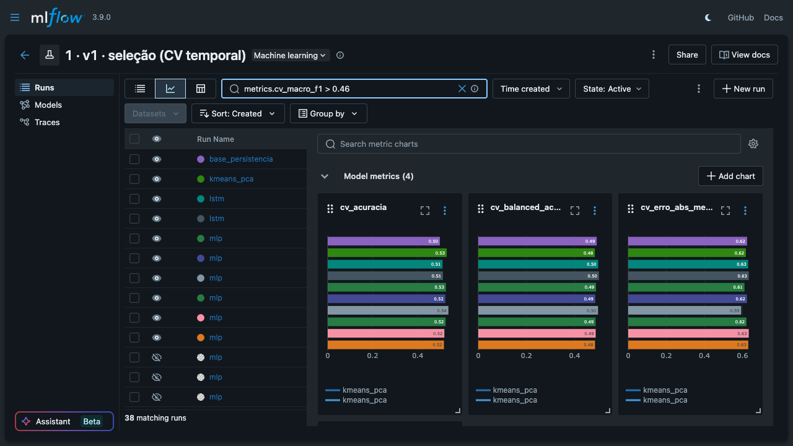
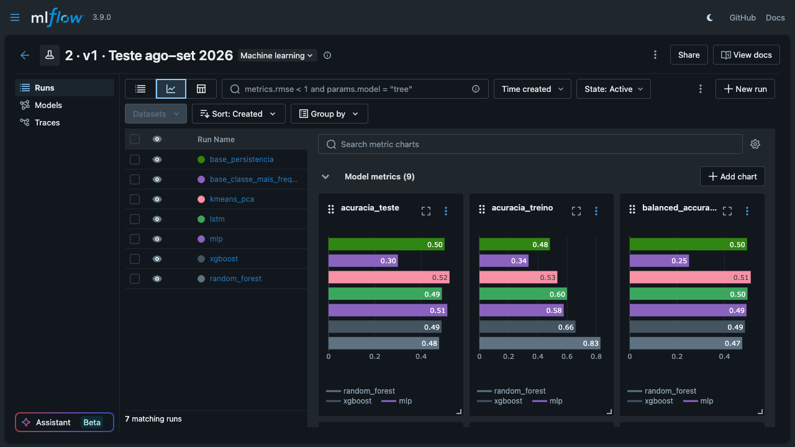
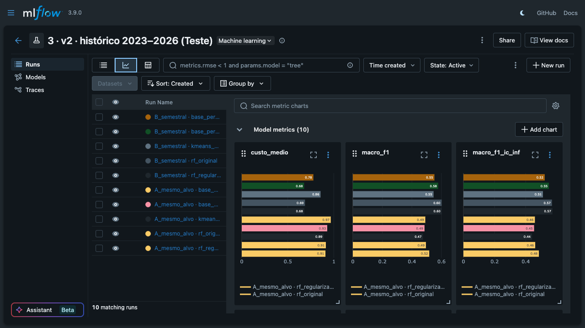
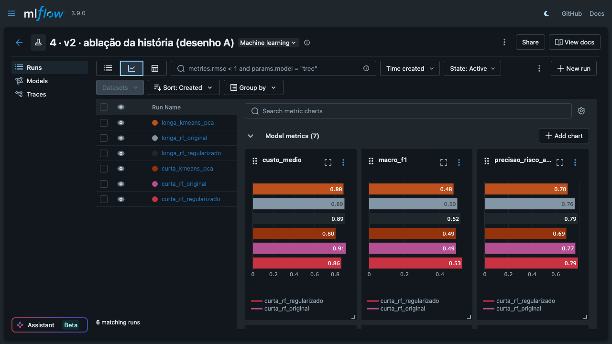
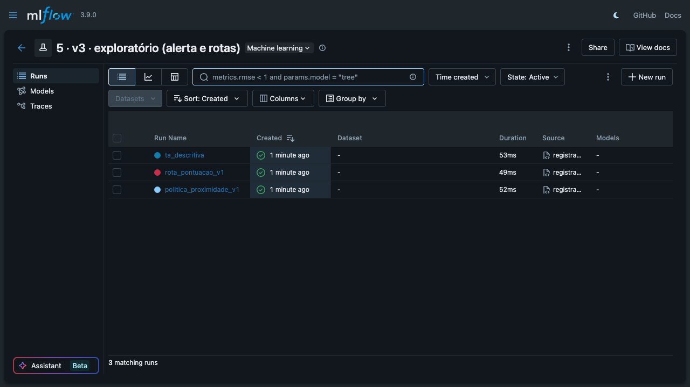

# hoodi — módulo de Machine Learning (Global Solution CitizenTech, FIAP)

> **Natureza do resultado:** mapa **histórico observado** de ocorrências registradas pela SSP-SP (contrato de entrega v2: jan–set/2026), por área (célula H3, resolução 9) e faixa horária. **Não** é previsão, **não** é risco em tempo real e **não** aponta lugar seguro. O backtest é retrospectivo.

Este repositório contém **somente o módulo de ML** do hoodi: ingestão do dado público, construção do rótulo, avaliação temporal de modelos, calibração e o mapa de níveis que o app consome. O foco aqui é o **processo de ML**: dado, rótulo, protocolo, modelos, resultados e decisão.

## Ficha CitizenTech
- **Equipe e RMs:** Abner Barbosa (RM558468), Beatriz Vieira de Novais (RM554746), Fernando Antonio (RM555201) e Mariana Neugebauer (RM550494).
- **Desafio / problema:** quem se desloca pela cidade decide trajetos e horários sem informação organizada sobre onde e quando houve ocorrências. O hoodi oferece apoio à decisão, com base em dado oficial (SSP-SP), para evitar vias e rotas de maior exposição histórica.
- **Público-alvo:** pessoas ativas que andam a pé por São Paulo, em geral com trabalho presencial ou híbrido. O app avisa, de forma ambiente, quando a pessoa entra em área com ocorrências registradas. Rotas de carro ficam para a fase 2 e exigem avaliação própria do ML (o dado atual não distingue crime contra veículo; ver Limites).
- **ODS relacionados:** ODS 11, Cidades e Comunidades Sustentáveis (principal, meta 11.2); ODS 16, Paz, Justiça e Instituições Eficazes (secundário).
- **Justificativa dos ODS:** ODS 11: o hoodi apoia a decisão de deslocamento na cidade, com alerta ambiente a pé por exposição histórica a ocorrências, em linha com a meta de transporte mais seguro. ODS 11 é o principal. ODS 16 (secundário): usa só dado público oficial (SSP-SP), com método, limites e código abertos. É um indicador histórico observado, não garantia de segurança nem previsão.

## Sumário
1. [O processo de ML](#o-processo-de-ml)
2. [Resultados](#resultados)
3. [O que este módulo entrega](#o-que-este-módulo-entrega)
4. [Como reproduzir](#como-reproduzir)
5. [Testes](#testes)
6. [Estrutura do repositório](#estrutura-do-repositório)
7. [Evidências do processo](#evidências-do-processo)
8. [Limites conhecidos](#limites-conhecidos)

## O processo de ML

```
SSP-SP (XLSX público) → ingestão e reconciliação → rótulo por célula H3 × faixa
   → features só do passado → treino/validação temporais → teste (ago–set/2026)
   → intervalos por bootstrap → calibração → decisão → snapshot CSV + SHA-256
```

### 1. Dados
- **Fonte:** SSP-SP, portal da Transparência, `SPDadosCriminais_2026.xlsx` (URL e SHA-256 em `ml/dados/README.md`; o conversor aborta se o hash divergir). Dado real, não simulado.
- **Janela e recorte:** jan–set/2026, perímetro de 5×5 km em volta da FIAP Paulista.
- **Volume:** 814.900 linhas no arquivo; 20.657 com coordenada e hora dentro do perímetro; **20.343 usadas na modelagem** (após remover 307 fora da janela e duplicatas/conflitos de BO).
- **Reconciliação:** entrada = usadas + quarentena + duplicatas + fora da janela, sem resto. Linhas sem hora, sem coordenada ou com BO conflitante vão para quarentena com o motivo registrado (`ml/dados/reconciliacao*.txt`).
- **O dado bruto não está no Git.** Só agregados por célula e faixa são versionados.

### 2. Rótulo
- **Unidade:** célula H3 resolução 9 (≈ 0,1 km²) × 5 faixas horárias: madrugada [0,6), manhã [6,12), tarde [12,18), noite cedo [18,21), noite [21,24). São 279 células × 5 faixas = 1.395 chaves.
- **Alvo:** `pontuacao_mensal` = soma dos pesos ÷ 9 meses ÷ horas da faixa; `nivel` 0–3 pelos três cortes de quartil calculados **só no treino**.
- **Supressão k ≥ 3:** chaves com 1 ou 2 registros viram `sem_dado`, nunca nível 0. Resultado: 954 `com_dado` e 441 `sem_dado` (223 sem registro, 218 suprimidas).

### 3. Protocolo de avaliação
- Divisão **temporal**: origens T1–T4 no treino (3.132 exemplos); teste ago–set/2026 (847 exemplos).
- Features só com meses anteriores ao alvo; validação cruzada com expurgo, só no treino.
- **Seleção pré-registrada:** o vencedor da CV (Random Forest) foi gravado em `selecao_modelo.json` antes de abrir o teste.
- Intervalos por bootstrap pareado, 2.000 reamostras por célula.
- Tudo o que veio depois da abertura do teste é **exploração com `test_seen = true`**: RF regularizado, LSTM, KMeans+PCA, regra de custo, histórico 2023–2025 e calibração.

### 4. Modelos testados
| Modelo | Situação | Por que entrou |
|---|---|---|
| Classe mais frequente, persistência (nível da janela anterior) | base | piso e a base realista a bater |
| Random Forest | pré-registrado | não paramétrico, robusto, explicável por importância |
| XGBoost, MLP | pré-registrados | mais liberdade de ajuste, para medir o que ela agrega |
| LSTM | exploração | testa estrutura sequencial no histórico |
| KMeans + PCA | exploração | abordagem não supervisionada |
| Random Forest regularizado (`max_depth` 6, `min_samples_leaf` 80) | exploração | limita a liberdade do RF; hiperparâmetros escolhidos por CV |

## Resultados

Teste ago–set/2026, n = 847. Tabela completa (custo médio, recall e precisão de risco alto) em `RELATORIO_ML.md`, seção 4.

| Modelo | Macro-F1 [IC 95 %] | Gap treino−teste |
|---|---|---|
| Persistência | 0,491 [0,457; 0,524] | −0,02 |
| Random Forest pré-registrado | 0,467 [0,432; 0,500] | **0,36** |
| XGBoost | 0,476 [0,441; 0,509] | 0,17 |
| MLP | 0,477 [0,443; 0,510] | 0,05 |
| LSTM | 0,492 [0,459; 0,525] | 0,09 |
| KMeans + PCA | 0,503 [0,467; 0,535] | −0,01 |
| **Random Forest regularizado** (exploratório) | **0,513 [0,479; 0,546]** | ≈ 0 |

- **Descoberta:** os modelos com mais liberdade de ajuste foram os mais sensíveis ao ruído do dado. Os registros são esparsos e variam de mês a mês; o RF pré-registrado sobreajusta (gap 0,36) e a regularização escolhida por CV leva o gap a ≈ 0.
- A diferença pareada RF regularizado − persistência em macro-F1 é +0,022 [−0,010; 0,052]: **não ficou estabelecida**. O regularizado foi escolhido depois de ver o teste (`test_seen = true`): evidência exploratória, não prova de superioridade.
- Calibração: ECE 0,047 sem pós-processamento; a calibração isotônica piorou para 0,105 e foi rejeitada.
- **Decisão:** nenhum modelo superou a persistência de forma estabelecida. O que vai para o app é o **mapa observado** (média histórica por célula), determinístico e explicável, não a saída de um modelo.

### Rastreio no MLflow

Os resultados já gravados em `ml/dados/resultados/` foram registrados no MLflow local (`scripts/registrar_mlflow.py`), sem retreinar nada, para comparar as execuções. A fonte da verdade continua sendo os JSON/CSV versionados.

| Experimento | Print |
|---|---|
| 1 · v1, seleção por validação cruzada |  |
| 2 · v1, treino e teste |  |
| 3 · v2, histórico 2023–2026 (desenhos A e B) |  |
| 4 · v2, ablação de histórico |  |
| 5 · v3, exploratório (alerta e rotas) |  |

## O que este módulo entrega

| Entregável | Onde |
|---|---|
| Notebook documentado de ponta a ponta, executado | `ml/hoodi_ml_documentado.ipynb` (cópia em `notebooks/`) |
| Relatório com métricas, intervalos, calibração e limites | `RELATORIO_ML.md` |
| **Snapshot v2 (contrato de entrega)**: 954 chaves `com_dado`, SHA-256 `2dddef701bdecb65142874980f1ae5aba7b2ac6ab2abad5c47b07f07ecc5080a` | `ml/dados/snapshot/` |
| Métricas, seleção, calibração e backtest agregado | `ml/dados/resultados/` |
| Proveniência, inventário e privacidade dos dados | `ml/dados/README.md` |
| Registro dos prompts de IA usados | `prompts.md` |

O snapshot é um CSV (`h3_cell`, `faixa`, `status`, `nivel`, `pontuacao_mensal`, `n_registros`) com SHA-256 obrigatório; consumidor com hash diferente falha fechado. Contrato completo em `specs/001-risco-h3-faixa-horaria/contracts/snapshot-risco.md`. O candidato v3 (semestral, abr–set/2026, 824 chaves) e os derivados de alerta e rota (`docs/contratos-v3/`) são da fase 2 e não foram adotados: o ganho de estabilidade não justificou trocar o padrão, e a janela foi escolhida em teste exploratório já visto.

**Privacidade:** nenhuma coordenada de ocorrência, número de BO ou campo individual é versionado; só agregados por célula e faixa, com supressão k ≥ 3. Hash obrigatório em todos os derivados.

## Como reproduzir

Requisitos: Python 3.11; no macOS, `brew install libomp` para o XGBoost.

```bash
python3.11 -m venv .venv && source .venv/bin/activate
pip install -r requirements.txt

# 1. Baixe SPDadosCriminais_2026.xlsx da SSP-SP (URL e sha256 em ml/dados/README.md)
export HOODI_XLSX_DIR=~/Downloads
python scripts/00_xlsx_para_parquet.py      # aborta se o sha256 divergir
python -m ml.ingestao                        # ml/dados/processed/usadas.parquet
python -m ml.gerar_snapshot                  # snapshot + manifest + fixture
python -m ml.modelos                         # seleção por CV e avaliação no teste
python -m ml.incerteza_custo                 # IC por bootstrap, RF regularizado e custo
python -m ml.calibracao                      # calibração, estratos e backtest agregado

pytest -q
```

O snapshot regenerado tem o mesmo SHA-256 do versionado; só o campo `gerado_em` do manifesto muda. O conversor cria `ml/dados/interim/` e instala/carrega a extensão `excel` do DuckDB (a primeira execução precisa de rede).

Para reexecutar o notebook: `jupyter nbconvert --execute --to notebook --inplace ml/hoodi_ml_documentado.ipynb`, rodando de dentro de `ml/` ou `notebooks/` (caminhos relativos). `scripts/gerar_notebook.py` está aposentado e não deve ser executado: sobrescreveria o notebook com uma versão antiga.

## Testes

`pytest -q` coleta 115 testes em 20 arquivos de teste. O que garantem:

| Grupo | Arquivos | Garantia |
|---|---|---|
| Reconciliação do dado | `test_quarentena`, `test_dedup`, `test_janela`, `test_schema_processed` | nada se perde nem se duplica na ingestão |
| Sem vazamento temporal | `test_split_temporal`, `test_cortes_treino`, `test_features_taxas` | teste nunca entra no treino; cortes só do treino |
| Contrato do snapshot | `test_snapshot`, `test_sem_dado`, `test_idempotencia`, `test_schemas_derivados` | k ≥ 3, `sem_dado` sem nível, hash reproduzível |
| Modelagem | `test_calibracao`, `test_sequenciais`, `test_ta_descritiva`, `test_v2_historico` | métricas, backtest agregado sem célula/faixa, histórico v2 |

Os testes de modelagem importam `torch` e são os mais lentos. `test_ta_descritiva` precisa de `ml/dados/processed/` (gerado pela ingestão; não versionado).

## Estrutura do repositório

```
ml/                 ingestão, rótulo, features, modelos, calibração, snapshot
ml/dados/snapshot/  snapshot v2, sha256, manifest e fixture (entregáveis)
ml/dados/resultados/ métricas, seleção, calibração e backtest agregado (JSON/CSV)
notebooks/          notebook documentado e executado (cópia em ml/)
scripts/            conversão do XLSX, qualidade do dado, registro no MLflow
docs/               especificação, red-team, decisões de privacidade, prints do MLflow
docs/fase2-produto/ alerta e rotas (fase 2, fora do escopo de ML)
specs/              spec-kit: spec, plano, modelo de dados, contrato e tarefas
tests/              suíte pytest
RELATORIO_ML.md     relatório técnico
```

## Evidências do processo

O trabalho seguiu especificação antes do código (`specs/`, `docs/SPEC-ML.md`), pré-registro dos candidatos e revisão independente em cada fase. A revisão foi feita por um revisor automatizado separado (Codex CLI, somente leitura); os relatórios estão preservados sem edição. Esta tabela resume o que cada fase encontrou e o que mudou no método ou nos números:

| Fase | Relatórios | Principais achados | O que mudou |
|---|---|---|---|
| Especificação (6 rodadas) | `docs/REDTEAM-SPEC-rodada1…6.md`, `docs/DECISOES-REDTEAM-rodada3.md` | Fórmula do rótulo ambígua (soma × taxa mensal); teste já usado na aprovação de uma tarefa; privacidade sem verificação | Fórmula única (pesos ÷ meses ÷ horas da faixa) com teste numérico; teste reservado; supressão k ≥ 3 |
| Pipeline v2 e histórico (4 rodadas) | `docs/REDTEAM-V2-rodada1…4.md` | Coordenadas persistidas em `processed/`; validação contaminada pelos cortes do próprio período; evidência pareada sobre o modelo errado; "mais histórico não ajuda" forte demais | Coordenadas removidas; cortes só do treino; comparações pareadas sobre o vencedor; conclusão reescrita como inconclusiva (IC inclui zero) |
| Entrega (4 rodadas) | `docs/REDTEAM-ENTREGA-rodada1…4.md`, `docs/DECISAO-PRIVACIDADE-SNAPSHOT-V2.md` | Ficha ausente; backtest permitia recuperar contagens por subtração; receita de reprodução falhava em checkout limpo; 218 pares suprimidos | Contrato v2 (954 chaves); backtest só agregado; reprodução corrigida; 0 bloqueantes ao final |
| Código e privacidade do v3 | `docs/REDTEAM-CODEX-2026-11-18.md`, `docs/REVISAO-CODIGO-2026-11-16.md` | Itens rastreados e consistência do snapshot candidato | Corrigidos; v3 não adotado |

Cada relatório lista os achados com arquivo e linha, severidade e a correção aplicada. O registro dos prompts de IA está em `prompts.md`.

Os documentos de alerta de proximidade e escolha de rota (proposta, plano, decisões e as revisões desses textos) tratam de produto e de fase 2; ficam em `docs/fase2-produto/` e não fazem parte da avaliação do processo de ML.

## Limites conhecidos

- O mapa descreve **registros**, não ocorrências reais: subnotificação e variação de registro entre regiões afetam o resultado.
- Nove meses de dado; sem validação com pessoas em uso real. O backtest é retrospectivo.
- A seleção do RF foi pré-registrada; tudo o que veio depois do teste é exploratório.
- Próximos passos em `RELATORIO_ML.md`, seção 10.
